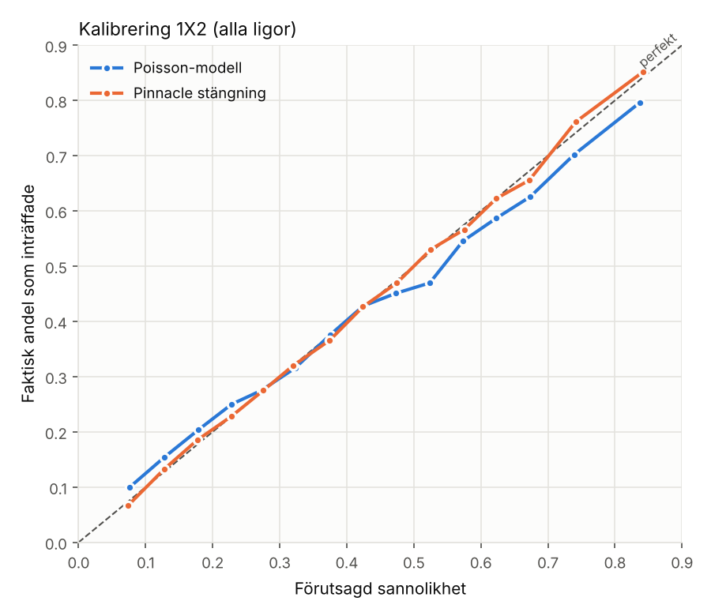
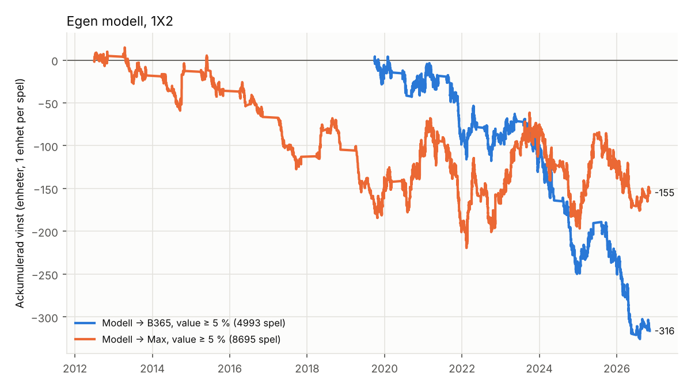
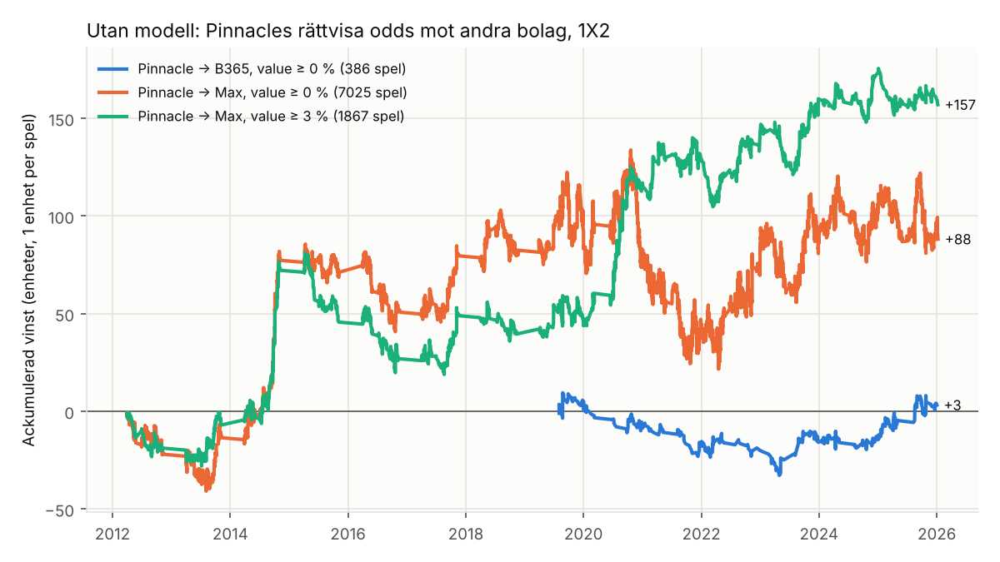

# Backtest fas 1 – Poisson-modell mot marknaden

*Genereras av `python3 -m src.report`. Tabellerna räknas om varje gång. Texten är skriven för hand utifrån körningen 2026-11-16.*

## Kort svar

**Den egna Poisson-modellen slår inte marknaden.** Den förutsäger sämre än Pinnacles stängningsodds i alla ligor och marknader. Att spela på dess "value" har gett förlust mot vanliga bolag (B365 −5 till −6 %, snittodds cirka −8 %), och ROI-intervallen ligger under noll. Mot `Max`-odds ligger resultatet runt noll, men det gör också att spela *alla* matcher på `Max`. Modellen tillför alltså ingenting.

**Strategin utan modell är intressant men inte bevisad.** Den räknar bort marginalen från Pinnacles odds och spelar när ett annat bolag ger mer:
- **Pinnacle → Max, value ≥ 3 %:** 1 867 spel, ROI +8 % (95 % KI +0,6 … +16,5 %) och positiv CLV i 91 % av spelen. Det är enda intervallet som ligger över noll, men två tredjedelar av spelen kommer från Allsvenskan, och `Max` innehåller odds vi kanske inte hade kunnat spela på.
- **Pinnacle → B365:** positiv CLV, men för få spel för att säga något om ROI.

Vi har testat ett 40-tal kombinationer, så att *ett* intervall hamnar över noll kan vara slump. Det här ska följas upp framåt med riktiga svenska odds (fas 3), inte byggas på direkt.

## Data och upplägg

- **Ligor:** Premier League (E0) och Championship (E1) 2019/20–2025/26 samt Allsvenskan (SWE) 2012–2026, totalt 10 132 matcher. Modellen kunde förutsäga 9 565 av dem.
- **Rullande backtest:** för varje matchdag tränas modellen bara på samma ligas matcher från de senaste 365 dagarna och strikt före dagen. Ett test (`tests/test_backtest.py`) bevisar att en prediktion inte påverkas av framtida resultat.
- **Säsongsstart:** matcher där ett lag har färre än 3 matcher i fönstret hoppas över, främst uppflyttade lag. Regression mot snittet görs med k = 5 "låtsasmatcher" på ligasnittsnivå. k valdes i förväg och har **inte** justerats för att få bättre resultat.
- **Marknaden:** Pinnacles odds med marginalen bortränkad enligt *potensmetoden* (p = q^k). Den ger skrällar lite lägre sannolikhet än proportionell normalisering och passar utfallen bättre (lägre log loss). Se avsnitt 4 om varför detta spelar roll.
- **Odds vi spelar på:** i E0/E1 används de tidiga oddsen, som football-data samlar in några dagar före match och som modellen realistiskt kunde ha spelat på. I SWE finns bara stängningsodds.
- **Insats:** 1 enhet per spel, och högst ett spel per match och marknad (utfallet med högst value).
- **CLV:** oddset vi tog × Pinnacles marginalfria stängningssannolikhet − 1. Positivt betyder att vi fick bättre odds än det slutliga rättvisa priset.
- **95 % KI:** bootstrap med 5 000 omdragningar av spelen.

### Begränsningar i datan

1. **Pinnacle-odds saknas från mitten av 2025.** Pinnacle slutade leverera till football-data. För E0/E1 2025/26 saknas en stor del och för Allsvenskan 2026 allt. Matcher utan Pinnacle-odds räknas inte med i jämförelserna mot marknaden.
2. **`Max` är ett för optimistiskt riktmärke.** Det är det högsta oddset bland många bolag, varav flera inte är tillgängliga i Sverige, och några är gamla eller felaktiga. Bevis: att spela *alla* utfall på `Max`-oddset ger nästan nollresultat, trots att det inte innehåller någon kunskap alls.
3. **Allsvenskan har bara stängningsodds** och B365 bara från 2025. CLV i SWE mäts därför samtidigt som spelet läggs och betyder lite där.
4. **Det finns inga BTTS-odds.** BTTS beräknas av modellen men kan inte utvärderas mot odds.

## 1. Träffsäkerhet: modell mot marknad

Lägre är bättre. Samma matcher jämförs (de där Pinnacles stängningsodds finns).

**1X2**

| Liga | Matcher | Log loss modell | Log loss Pinnacle | Brier modell | Brier Pinnacle |
|---|---|---|---|---|---|
| E0 | 2338 | 0.9992 | 0.9610 | 0.5953 | 0.5698 |
| E1 | 3379 | 1.0663 | 1.0365 | 0.6440 | 0.6229 |
| SWE | 3161 | 1.0283 | 0.9800 | 0.6176 | 0.5838 |

**Över/under 2,5** (bara E0/E1, SWE saknar dessa odds)

| Liga | Matcher | Log loss modell | Log loss Pinnacle | Brier modell | Brier Pinnacle |
|---|---|---|---|---|---|
| E0 | 2327 | 0.6937 | 0.6753 | 0.4997 | 0.4824 |
| E1 | 3379 | 0.7023 | 0.6820 | 0.5074 | 0.4889 |

Skillnaden är stor. 0,03–0,05 i log loss är ungefär skillnaden mellan en marknad och en bra amatörmodell. Modellen är sämre i varje liga.

### Varför? Modellen är överkonfident

Pinnacles linje ligger nästan på diagonalen, alltså inträffar det de säger med rätt frekvens. Modellens linje är flackare. När modellen säger 15–20 % inträffar det oftare än så, och när den säger 70 % inträffar det mer sällan. Den drar för långtgående slutsatser av för lite data:

- Hemma- och bortastyrkor räknas var för sig, så varje lag har bara cirka 19 hemmamatcher per säsong att räkna på.
- k = 5 låtsasmatcher är för lite regression mot snittet.
- Alla matcher det senaste året väger lika, inga justeringar görs för motståndets styrka och resultaten är brusiga, eftersom mål är sällsynta.

Följden är att modellens sannolikhet för hemmaseger i snitt avviker 8,5 procentenheter från marknadens och ser "value" i nästan varje match. Det är brus, inte ett övertag.

## 2. Spel enligt modellen

"alla" = spela det bästa utfallet i varje match oavsett value. Det är ett riktmärke för vad oddset ger utan kunskap.

**1X2**

| Odds | Value-tröskel | Spel | Snittodds | ROI | 95 % KI för ROI | Vinst (enh.) | Max drawdown | Snitt-CLV |
|---|---|---|---|---|---|---|---|---|
| b365 | alla | 6474 | 3.86 | -5.4 % | -9.3 % … -1.3 % | -349.0 | 362.7 | -6.4 % |
| b365 | ≥ 0% | 5898 | 3.97 | -5.4 % | -9.6 % … -1.2 % | -320.6 | 336.0 | -6.6 % |
| b365 | ≥ 3% | 5324 | 4.08 | -6.1 % | -10.7 % … -1.5 % | -326.5 | 340.9 | -6.7 % |
| b365 | ≥ 5% | 4993 | 4.15 | -6.3 % | -10.9 % … -1.5 % | -316.2 | 329.8 | -6.8 % |
| b365 | ≥ 10% | 4155 | 4.36 | -5.2 % | -10.4 % … +0.2 % | -215.2 | 247.2 | -7.2 % |
| avg | alla | 9565 | 3.88 | -8.0 % | -11.1 % … -4.8 % | -764.1 | 781.5 | -7.2 % |
| avg | ≥ 0% | 8733 | 3.99 | -7.7 % | -10.9 % … -4.2 % | -670.0 | 696.7 | -7.3 % |
| avg | ≥ 3% | 7940 | 4.10 | -8.1 % | -11.7 % … -4.4 % | -640.2 | 662.2 | -7.5 % |
| avg | ≥ 5% | 7416 | 4.17 | -8.7 % | -12.5 % … -5.0 % | -645.9 | 663.9 | -7.7 % |
| avg | ≥ 10% | 6172 | 4.40 | -8.8 % | -12.9 % … -4.6 % | -545.7 | 560.2 | -8.1 % |
| max | alla | 9565 | 4.37 | -1.9 % | -5.4 % … +1.7 % | -182.4 | 236.6 | -1.1 % |
| max | ≥ 0% | 9491 | 4.38 | -2.1 % | -5.7 % … +1.6 % | -199.6 | 235.5 | -1.1 % |
| max | ≥ 3% | 9102 | 4.44 | -1.8 % | -5.5 % … +2.0 % | -163.7 | 242.6 | -1.1 % |
| max | ≥ 5% | 8695 | 4.50 | -1.8 % | -5.6 % … +1.9 % | -154.8 | 234.0 | -1.1 % |
| max | ≥ 10% | 7531 | 4.71 | -2.1 % | -5.9 % … +2.2 % | -154.9 | 191.0 | -1.1 % |

**Över/under 2,5**

| Odds | Value-tröskel | Spel | Snittodds | ROI | 95 % KI för ROI | Vinst (enh.) | Max drawdown | Snitt-CLV |
|---|---|---|---|---|---|---|---|---|
| b365 | alla | 6168 | 1.96 | -3.5 % | -5.9 % … -1.1 % | -214.1 | 227.9 | -5.1 % |
| b365 | ≥ 0% | 4975 | 1.98 | -3.0 % | -5.9 % … -0.3 % | -150.7 | 170.2 | -5.1 % |
| b365 | ≥ 3% | 4273 | 1.99 | -3.0 % | -6.0 % … -0.1 % | -127.2 | 141.8 | -5.1 % |
| b365 | ≥ 5% | 3839 | 2.00 | -3.3 % | -6.4 % … -0.1 % | -127.7 | 137.6 | -5.2 % |
| b365 | ≥ 10% | 2807 | 2.02 | -2.7 % | -6.5 % … +1.0 % | -76.4 | 89.1 | -5.4 % |
| avg | alla | 6170 | 1.96 | -3.7 % | -6.1 % … -1.2 % | -229.7 | 243.2 | -5.3 % |
| avg | ≥ 0% | 4920 | 1.97 | -3.1 % | -5.8 % … -0.3 % | -151.6 | 174.0 | -5.3 % |
| avg | ≥ 3% | 4205 | 1.98 | -3.4 % | -6.3 % … -0.3 % | -141.1 | 153.0 | -5.4 % |
| avg | ≥ 5% | 3757 | 1.99 | -3.0 % | -6.2 % … +0.2 % | -112.9 | 123.9 | -5.4 % |
| avg | ≥ 10% | 2743 | 2.02 | -4.2 % | -8.0 % … -0.4 % | -114.4 | 127.2 | -5.7 % |
| max | alla | 6170 | 2.04 | -0.1 % | -2.7 % … +2.5 % | -7.3 | 71.6 | -1.7 % |
| max | ≥ 0% | 5778 | 2.04 | -0.1 % | -2.8 % … +2.4 % | -6.8 | 70.0 | -1.7 % |
| max | ≥ 3% | 5080 | 2.05 | +0.3 % | -2.7 % … +3.1 % | +15.8 | 80.9 | -1.7 % |
| max | ≥ 5% | 4627 | 2.06 | -0.2 % | -3.1 % … +2.8 % | -7.3 | 73.9 | -1.7 % |
| max | ≥ 10% | 3516 | 2.08 | +0.3 % | -3.2 % … +3.7 % | +9.3 | 63.3 | -1.8 % |

Tolkning:
- **B365 och snittodds:** konsekvent förlust på −3 till −9 %, med negativ CLV på cirka −5 %. Det motsvarar ungefär bolagens marginal, så modellen tillför ingenting.
- **Max:** runt noll, men lika bra som att spela "alla". Value-tröskeln förbättrar alltså inte resultatet. Det som syns är att `Max` i sig är för generöst, inte att modellen fungerar.
- **Högre tröskel hjälper inte.** Om modellen hade ett övertag skulle ROI stiga med tröskeln. Det gör den inte.

## 3. Strategi utan egen modell: Pinnacle som "sanning"

Räkna bort marginalen från Pinnacles odds (samma tidpunkt som spelet) och spela när ett annat bolag ger högre odds än det rättvisa. I E0/E1 jämförs tidiga odds med tidiga odds och i SWE stängning med stängning.

**1X2**

| Odds | Value-tröskel | Spel | Snittodds | ROI | 95 % KI för ROI | Vinst (enh.) | Max drawdown | Snitt-CLV |
|---|---|---|---|---|---|---|---|---|
| b365 | alla | 6132 | 2.79 | -3.6 % | -6.9 % … -0.2 % | -218.3 | 264.0 | -3.0 % |
| b365 | ≥ 0% | 386 | 3.80 | +0.8 % | -16.5 % … +18.8 % | +3.2 | 42.3 | +1.4 % |
| b365 | ≥ 3% | 56 | 4.85 | +59.3 % | -5.1 % … +136.1 % | +33.2 | 7.0 | +3.1 % |
| b365 | ≥ 5% | 20 | 4.58 | -7.8 % | -65.0 % … +53.6 % | -1.6 | 3.0 | +7.2 % |
| b365 | ≥ 10% | 6 | 5.42 | -64.2 % | -100.0 % … +7.5 % | -3.9 | 3.9 | +13.2 % |
| max | alla | 9426 | 3.11 | +0.9 % | -1.9 % … +3.9 % | +88.4 | 114.3 | +1.5 % |
| max | ≥ 0% | 7025 | 3.27 | +1.3 % | -2.2 % … +4.8 % | +88.2 | 112.0 | +2.3 % |
| max | ≥ 3% | 1867 | 4.29 | +8.4 % | +0.6 % … +16.5 % | +157.0 | 62.0 | +5.8 % |
| max | ≥ 5% | 874 | 5.02 | +11.2 % | -0.7 % … +24.0 % | +97.5 | 33.7 | +8.2 % |
| max | ≥ 10% | 203 | 6.92 | +8.9 % | -20.1 % … +38.3 % | +18.1 | 18.9 | +14.4 % |

**Över/under 2,5**

| Odds | Value-tröskel | Spel | Snittodds | ROI | 95 % KI för ROI | Vinst (enh.) | Max drawdown | Snitt-CLV |
|---|---|---|---|---|---|---|---|---|
| b365 | alla | 6045 | 1.81 | -4.4 % | -6.7 % … -2.1 % | -266.0 | 285.5 | -3.4 % |
| b365 | ≥ 0% | 51 | 2.16 | -1.7 % | -30.4 % … +28.6 % | -0.9 | 7.9 | +1.2 % |
| b365 | ≥ 3% | 9 | 3.35 | +0.0 % | -100.0 % … +104.4 % | +0.0 | 2.0 | +5.3 % |
| b365 | ≥ 5% | 8 | 3.26 | -37.5 % | -100.0 % … +47.5 % | -3.0 | 4.0 | +5.8 % |
| b365 | ≥ 10% | 2 | 3.77 | +60.0 % | -100.0 % … +220.0 % | +1.2 | 1.0 | +15.1 % |
| max | alla | 6047 | 1.88 | -0.4 % | -2.7 % … +2.0 % | -23.1 | 109.1 | -0.2 % |
| max | ≥ 0% | 2154 | 1.91 | +1.7 % | -2.3 % … +5.7 % | +37.6 | 40.9 | +1.6 % |
| max | ≥ 3% | 142 | 2.12 | +18.7 % | +1.2 % … +36.6 % | +26.6 | 11.4 | +6.1 % |
| max | ≥ 5% | 32 | 2.59 | +14.1 % | -30.8 % … +61.1 % | +4.5 | 4.0 | +11.7 % |
| max | ≥ 10% | 10 | 3.42 | +15.5 % | -69.1 % … +109.8 % | +1.5 | 2.0 | +23.4 % |

**Per liga, Pinnacle → Max, value ≥ 3 %**

| Liga | Spel | Snittodds | ROI | 95 % KI för ROI | Snitt-CLV |
|---|---|---|---|---|---|
| E0 | 351 | 6.23 | +5.9 % | -15.8 % … +29.5 % | +4.2 % |
| E1 | 246 | 3.62 | -3.0 % | -21.9 % … +16.3 % | +4.0 % |
| SWE | 1270 | 3.89 | +11.3 % | +1.9 % … +20.7 % | +6.6 % |

**Per liga, Pinnacle → B365, value ≥ 0 %**

| Liga | Spel | Snittodds | ROI | 95 % KI för ROI | Snitt-CLV |
|---|---|---|---|---|---|
| E0 | 94 | 4.35 | +11.9 % | -28.0 % … +58.2 % | +0.9 % |
| E1 | 270 | 3.70 | -6.9 % | -26.1 % … +13.3 % | +1.2 % |
| SWE | 22 | 2.75 | +48.6 % | -17.3 % … +122.2 % | +5.3 % |

Tolkning:
- **CLV är positiv i alla ligor och alla år** för Pinnacle → Max. Vi får alltså systematiskt bättre odds än Pinnacles rättvisa pris, och det mätvärdet är mycket stabilare än ROI.
- **ROI följer inte CLV överallt.** Allsvenskan ger klart plus, Premier League lite plus och Championship minus, trots positiv CLV även där. Per år svänger ROI från −20 % till +50 %. Det visar hur stor variansen är.
- **`Max` är problemet.** Det högsta oddset bland många bolag innehåller ibland felaktiga eller gamla odds och bolag som inte tar svenska kunder. I Allsvenskan jämförs dessutom Max-stängning med Pinnacle-stängning i samma ögonblick. Vi vet inte om de oddsen faktiskt gick att spela på.
- **B365** ger positiv CLV, men oddsen ligger sällan över Pinnacles rättvisa pris, så spelen blir för få för en slutsats.
- **Verkliga hinder:** bolag begränsar ofta kunder som systematiskt tar bättre odds än marknaden. Svenska bolag (Svenska Spel, ATG, Unibet m.fl.) finns inte i datan.

## 4. Känslighet: hur marginalen räknas bort

Bolagen lägger mer marginal på skrällar. Proportionell borttagning ger därför skrällar för hög rättvis sannolikhet, och då ser höga odds ut att ha "value" som inte finns. Potensmetoden passar Pinnacles utfall bättre (log loss 0,99738 mot 0,99754 för 1X2) och används därför som standard. Valet gjordes på log loss, men jag upptäckte problemet *efter* att ha sett resultaten, och det ska du känna till.

| Strategi | Metod | Spel | Snittodds | ROI | 95 % KI för ROI | Snitt-CLV |
|---|---|---|---|---|---|---|
| Pinnacle → b365, ≥ 0% | proportional | 698 | 5.42 | +5.2 % | -10.6 % … +21.3 % | +1.2 % |
| Pinnacle → b365, ≥ 0% | power | 386 | 3.80 | +0.8 % | -16.5 % … +18.8 % | +1.4 % |
| Pinnacle → b365, ≥ 3% | proportional | 170 | 7.66 | +28.4 % | -11.4 % … +72.9 % | +4.3 % |
| Pinnacle → b365, ≥ 3% | power | 56 | 4.85 | +59.3 % | -5.1 % … +136.1 % | +3.1 % |
| Pinnacle → max, ≥ 3% | proportional | 2662 | 6.32 | -2.3 % | -10.6 % … +5.8 % | +6.7 % |
| Pinnacle → max, ≥ 3% | power | 1867 | 4.29 | +8.4 % | +0.6 % … +16.5 % | +5.8 % |
| Pinnacle → max, ≥ 5% | proportional | 1451 | 7.72 | +0.1 % | -11.8 % … +12.8 % | +9.3 % |
| Pinnacle → max, ≥ 5% | power | 874 | 5.02 | +11.2 % | -0.7 % … +24.0 % | +8.2 % |

Med proportionell metod blir snittoddsen högre och ROI sämre för Max trots högre CLV. Det är tecknet på att den metoden överskattar skrällar.

## Slutsats och förslag

1. **Bygg inte vidare mot live och webbsida med nuvarande Poisson-modell.** Den har inget övertag och är för överkonfident.
2. **Fas 2 kan förbättra modellen, men sikta realistiskt.** Att slå Pinnacles stängningsodds med en ren målmodell är mycket svårt. Ett rimligt mål är att komma *nära* marknaden i log loss, så att modellen kan användas som ett filter ovanpå marknadens pris. Förbättringarna i tur och ordning:
   - Maximum likelihood-skattning med gemensamma attack- och försvarsstyrkor plus en hemmafördel, i stället för separata hemma- och bortasnitt. Det minskar bruset kraftigt.
   - Tidsviktning och Dixon-Coles.
   - Parametrarna (k, avklingning) väljs på tidiga säsonger och utvärderas på senare, aldrig på samma data.
3. **Det mest lovande spåret är marknadsstrategin** (Pinnacle eller en marginalfri konsensus som "sanning", spel när ett svenskt bolag ger mer). Det kan bara bevisas med riktiga, spelbara svenska odds. Fas 3 bör därför logga odds och stängningsodds från svenska bolag och mäta CLV framåt, i några månader, innan några pengar satsas.
4. **Notera:** Pinnacle-odds saknas i football-data från 2025. Ett live-API måste därför ha Pinnacle (eller ett annat skarpt bolag och börser som Betfair) för att strategin ska fungera.
