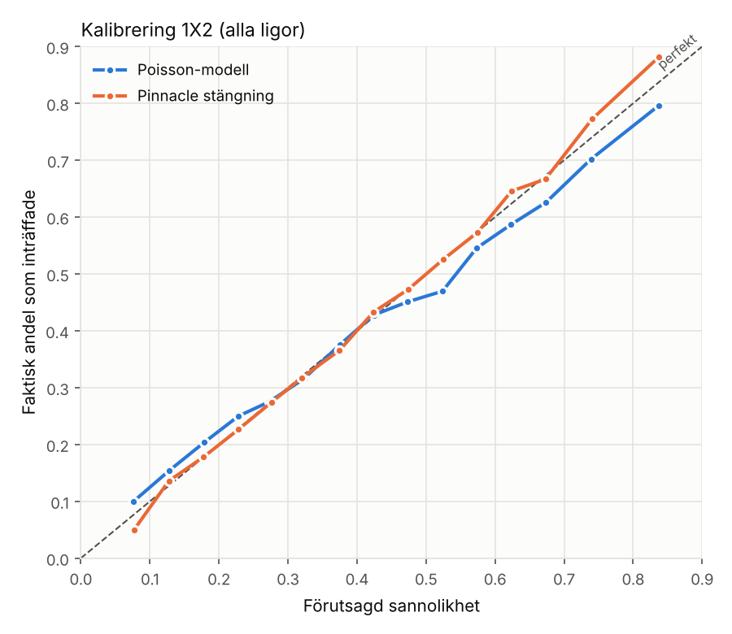
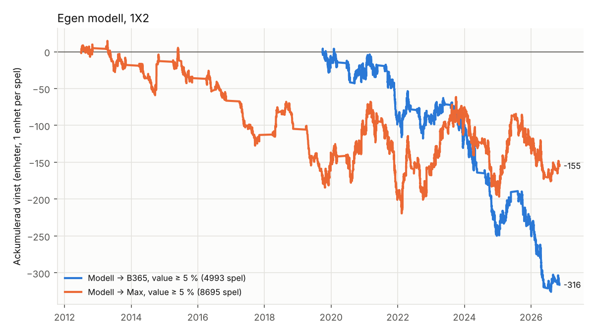
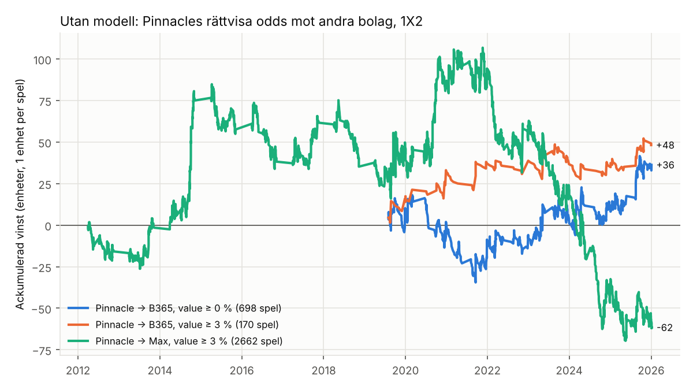

# Backtest fas 1 – Poisson-modell mot marknaden

*Genereras av `python3 -m src.report`. Tabellerna räknas om varje gång. Texten är skriven för hand utifrån körningen 2026-11-16.*

## Kort svar

**Modellen slår inte marknaden.** Den förutsäger sämre än Pinnacles stängningsodds i alla ligor och marknader. Att spela på dess "value" har gett förlust mot vanliga bolag (B365, snittodds). ROI-intervallen ligger helt eller nästan helt under noll. Mot `Max`-odds ligger resultatet runt noll, men det beror på att `Max` är för optimistiskt (se nedan) och inte på modellen.

**Strategin utan modell är det enda som ser lovande ut.** Den räknar bort marginalen från Pinnacles odds och spelar när B365 ger högre odds än det rättvisa. Den har gett positiv CLV, alltså bättre odds än Pinnacles rättvisa stängningsodds, nästan alla år. Antalet spel är dock litet och oddsen höga, så ROI-intervallet täcker fortfarande noll. Det är inte bevisat, men det är en riktig signal värd att följa upp.

## Data och upplägg

- **Ligor:** Premier League (E0) och Championship (E1) 2019/20–2025/26 samt Allsvenskan (SWE) 2012–2026, totalt 10 132 matcher. Modellen kunde förutsäga 9 565 av dem.
- **Rullande backtest:** för varje matchdag tränas modellen bara på samma ligas matcher från de senaste 365 dagarna och strikt före dagen. Ett test (`tests/test_backtest.py`) bevisar att en prediktion inte påverkas av framtida resultat.
- **Säsongsstart:** matcher där ett lag har färre än 3 matcher i fönstret hoppas över, främst uppflyttade lag. Regression mot snittet görs med k = 5 "låtsasmatcher" på ligasnittsnivå. k valdes i förväg och har **inte** justerats för att få bättre resultat.
- **Marknaden:** Pinnacles odds med marginalen bortränkad proportionellt.
- **Odds vi spelar på:** i E0/E1 används de tidiga oddsen, som football-data samlar in några dagar före match och som modellen realistiskt kunde ha spelat på. I SWE finns bara stängningsodds.
- **Insats:** 1 enhet per spel, och högst ett spel per match och marknad (utfallet med högst value).
- **CLV:** oddset vi tog × Pinnacles marginalfria stängningssannolikhet − 1. Positivt betyder att vi fick bättre odds än det slutliga rättvisa priset.
- **95 % KI:** bootstrap med 5 000 omdragningar av spelen.

### Begränsningar i datan

1. **Pinnacle-odds saknas från mitten av 2025.** Pinnacle slutade leverera till football-data. För E0/E1 2025/26 saknas en stor del och för Allsvenskan 2026 allt. Matcher utan Pinnacle-odds räknas inte med i jämförelserna mot marknaden.
2. **`Max` är ett för optimistiskt riktmärke.** Det är det högsta oddset bland många bolag, varav flera inte är tillgängliga i Sverige, och några är gamla eller felaktiga. Bevis: att spela *alla* utfall på `Max`-oddset ger nästan nollresultat, trots att det inte innehåller någon kunskap alls.
3. **Allsvenskan har bara stängningsodds** och B365 bara från 2025. CLV i SWE mäts därför samtidigt som spelet läggs och betyder lite där.
4. **Det finns inga BTTS-odds.** BTTS beräknas av modellen men kan inte utvärderas mot odds.

## 1. Träffsäkerhet: modell mot marknad

Lägre är bättre. Samma matcher jämförs (de där Pinnacles stängningsodds finns).

**1X2**

{{ACC_1X2}}

**Över/under 2,5** (bara E0/E1, SWE saknar dessa odds)

{{ACC_OU}}

Skillnaden är stor. 0,03–0,05 i log loss är ungefär skillnaden mellan en marknad och en bra amatörmodell. Modellen är sämre i varje liga.

### Varför? Modellen är överkonfident

Pinnacles linje ligger nästan på diagonalen, alltså inträffar det de säger med rätt frekvens. Modellens linje är flackare. När modellen säger 15–20 % inträffar det oftare än så, och när den säger 70 % inträffar det mer sällan. Den drar för långtgående slutsatser av för lite data:

- Hemma- och bortastyrkor räknas var för sig, så varje lag har bara cirka 19 hemmamatcher per säsong att räkna på.
- k = 5 låtsasmatcher är för lite regression mot snittet.
- Alla matcher det senaste året väger lika, inga justeringar görs för motståndets styrka och resultaten är brusiga, eftersom mål är sällsynta.

Följden är att modellen i snitt avviker 8,5 procentenheter från marknaden och ser "value" i nästan varje match. Det är brus, inte ett övertag.

## 2. Spel enligt modellen

"alla" = spela det bästa utfallet i varje match oavsett value. Det är ett riktmärke för vad oddset ger utan kunskap.

**1X2**

{{MODEL_1X2}}

**Över/under 2,5**

{{MODEL_OU}}

Tolkning:
- **B365 och snittodds:** konsekvent förlust på −3 till −9 %, med negativ CLV på cirka −5 %. Det motsvarar ungefär bolagens marginal, så modellen tillför ingenting.
- **Max:** runt noll, men lika bra som att spela "alla". Value-tröskeln förbättrar alltså inte resultatet. Det som syns är att `Max` i sig är för generöst, inte att modellen fungerar.
- **Högre tröskel hjälper inte.** Om modellen hade ett övertag skulle ROI stiga med tröskeln. Det gör den inte.

## 3. Strategi utan egen modell: Pinnacle som "sanning"

Räkna bort marginalen från Pinnacles odds (samma tidpunkt som spelet) och spela när ett annat bolag ger högre odds än det rättvisa.

**1X2**

{{PIN_1X2}}

**Över/under 2,5**

{{PIN_OU}}

Tolkning:
- **Pinnacle → B365 har positiv CLV.** Den är +1 % vid 0 % tröskel och +4 % vid 3 %, och positiv nästan varje år, med 2024 som undantag. CLV är ett mycket stabilare mått än ROI, för den visar om vi fått bra pris och inte om vi haft tur.
- **ROI är positiv men osäker.** Spelen är få (100–700) och har höga snittodds (5–8, mest oavgjort och bortaseger som skrällar). Därför är intervallen mycket breda och täcker noll.
- **Pinnacle → Max** ger fler spel men ingen tydlig vinst, vilket stämmer med att `Max` innehåller felaktiga och otillgängliga odds.
- **Verkliga hinder:** spelbolag som B365 begränsar ofta kunder som vinner på det här sättet. Svenska bolag (Svenska Spel, ATG, Unibet m.fl.) finns inte i datan, så vi vet inte om de beter sig som B365.

## Slutsats och förslag

1. **Bygg inte vidare mot live och webbsida med nuvarande modell.** Den har inget övertag.
2. **Fas 2 kan göra modellen bättre, men målet bör vara realistiskt.** Att slå Pinnacles stängningsodds med en målmodell är mycket svårt. Ett rimligt delmål är att komma *nära* marknaden i log loss. Förbättringarna i tur och ordning:
   - Maximum likelihood-skattning med gemensamma attack- och försvarsstyrkor plus en hemmafördel, i stället för separata hemma- och bortasnitt. Det halverar bruset.
   - Tidsviktning och Dixon-Coles.
   - Parametrarna (k, avklingning) väljs på tidiga säsonger och utvärderas på senare, aldrig på samma data.
3. **Det mest lovande spåret är Pinnacle-strategin** (eller en blandning: modellen som filter ovanpå marknadens pris). För att testa den mot *svenska* bolag behövs live-odds från ett API (fas 3) och att CLV loggas framåt. Det är där ett eventuellt övertag kan bevisas.
