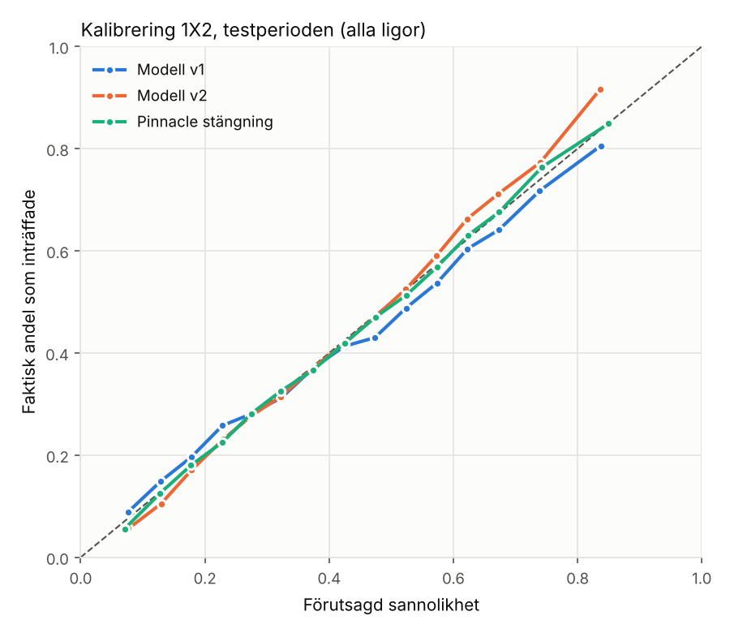
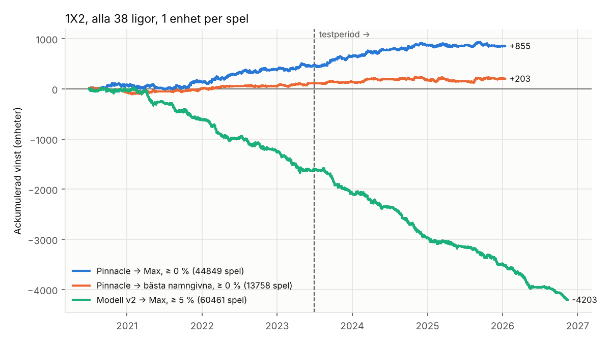

# Fas 2 – Bättre modell och sökning bland alla odds, ligor och marknader

*Genereras av `python3 -m src.report_phase2`. Tabellerna räknas om från data. Texten är skriven utifrån körningen 2026-11-16.*

## Kort svar

1. **Modell v2 är klart bättre än v1, men fortfarande sämre än marknaden.** Avståndet till Pinnacle i log loss har krympt med cirka 40 %, och förbättringen håller på testdata som modellen aldrig sett. Ändå är v2 sämre än Pinnacle i **alla 38 ligor**.
2. **Att spela på modellens "value" förlorar pengar överallt:** i alla marknader, mot alla bolag och i alla ligor. Inte en enda modellstrategi klarade urvalet.
3. **Det enda som håller utanför urvalsperioden är strategin utan egen modell:** spela när ett bolag ger högre odds än Pinnacles rättvisa pris. Mot `Max`-odds i alla ligor gav det **+2,3 % ROI på 16 414 testspel (95 % KI +0,1 … +4,5 %)** och positiv CLV. Mot bolag med namn, som vi vet går att spela hos, är resultatet bara +1,3 % och osäkert.

Det betyder: **jag hittar inget bevis för att Poisson-modellen hittar felsatta odds.** Det som finns är små prisskillnader mellan bolag. De går eventuellt att utnyttja, men bara om man har tillgång till rätt bolag i rätt ögonblick.

## Data

- **38 ligor och 117 389 matcher:** 22 huvudligor (England 1–5, Skottland 1–4, Tyskland, Italien, Spanien och Frankrike 1–2, Nederländerna, Belgien, Portugal, Turkiet, Grekland) 2019/20–2025/26, och 16 extraligor (bland annat Sverige, Norge, Danmark, Finland, USA, Brasilien och Japan) 2012–2026.
- **Marknader:**
  - 1X2 med 14 bolag plus `Max`/`Avg`.
  - Över/under 2,5 och asiatiskt handikapp med Pinnacle, Bet365, Betfair-börsen och `Max`/`Avg`. Extraligorna har bara 1X2.
- **"Bästa namngivna bolag"** är det högsta oddset bland B365, bwin, Interwetten, William Hill, VC, Betfair, Betfair-börsen, 1xBet, Betfred, BetMGM, BetVictor, Coral och Ladbrokes. Det är mer realistiskt än `Max`, som innehåller okända bolag.
- **Betfair-börsen** räknas med 5 % provision på vinster.
- **Datafel:** odds som är mer än 25 % över snittoddset för samma utfall räknas som datafel och används inte. Exempel: helgen 29 november 2025 har `Max` för asiatiskt handikapp 22,0 i flera ligor där alla bolag har cirka 1,9. Den regeln infördes efter att felet upptäcktes på testdatan, och den gör resultaten *sämre*, inte bättre.
- **Pinnacle saknas i football-data från mitten av 2025.** Testperioden för strategier som kräver Pinnacle tar därför i praktiken slut då.

## Upplägg: hitta och testa på olika data

| Period | Används till |
|---|---|
| **Validering** juli 2020 – juni 2023 | välja modellparametrar och strategier |
| **Test** juli 2023 – nov 2026 | bara utvärdering, efter att valen låsts |

Varje prediktion använder bara matcher före matchdagen (rullande, med test mot look-ahead som i fas 1).

## 1. Modell v2

v2 skattar *en* attack- och *en* försvarsstyrka per lag samt en hemmafördel per liga, med maximum likelihood. Gamla matcher väger mindre (halveringstid), och varje lag dras mot snittet med κ låtsasmatcher. Dixon-Coles korrigerar sannolikheterna för 0–0, 1–0, 0–1 och 1–1.

**Parametrarna valdes på valideringsdata** (48 kombinationer × 3 Dixon-Coles-varianter, se `reports/tuning_validation.csv`):
- Halveringstid 365 dagar (testade 90/180/365/730).
- κ = 10 (testade 2/5/10/20).
- Inget avdrag för uppflyttade lag (testade 1,0/0,9/0,8).
- Dixon-Coles med ρ = −0,05.

De bästa värdena låg inte i kanten av rutnätet. Dixon-Coles gav en mycket liten förbättring, och avdraget för uppflyttade lag ingen alls.

### Log loss (lägre är bättre, samma matcher för alla tre)

{{ACCURACY}}

v2 slår v1 tydligt, även på testperioden. Marknaden är fortfarande klart bättre: 0,02 i log loss är en stor skillnad.

### Per liga, testperioden, 1X2

{{PER_LEAGUE}}

v2 är bättre än Pinnacle i {{N_CLOSE}} av {{N_LEAGUES}} ligor. Närmast kommer den i lägre ligor (skotska fjärdedivisionen, Schweiz, Polen, National League), där marknaden har minst information. Längst ifrån är den i Kina, Turkiet och Bundesliga.

v1 är överkonfident: dess linje är flackare än diagonalen. v2 ligger nära diagonalen och är snarare lite för försiktig med stora favoriter (när den säger 75–85 % vinner favoriten ännu oftare). Felet i v2 sitter alltså inte i en grov snedvridning utan i enskilda matcher.

## 2. Spel enligt modell v2 (tröskel 5 %, alla ligor)

{{MODEL_BETS}}

**Alla är negativa, och alla har negativ CLV.** Bättre log loss gav alltså inte bättre spel. Förklaringen är urvalet: modellen avviker i snitt 6,4 procentenheter från marknaden i enskilda matcher. När vi spelar där avvikelsen är störst plockar vi fram modellens största misstag, oftast skrällar med höga odds. Modellen tror att de spelen har i snitt 25 % value, men utfallet blir −7 %.

## 3. Strategisökning

Varje kombination av:
- **Sannolikhetskälla:** modell, Pinnacle eller kombination (Pinnacle säger value *och* modellen håller med).
- **Marknad:** 1X2, Ö/U 2,5 eller AH.
- **Bolag** (alla, plus "bästa namngivna").
- **Liga:** var för sig eller alla tillsammans.
- **Tröskel:** 0, 3, 5 eller 10 %.

Det ger **{{N_STRATEGIES}} strategier.**

**Urvalsregel (bestämd före testet):** på valideringsperioden minst 100 spel, undre gränsen i ROI:s 95 %-intervall > 0 och snitt-CLV > 0. **{{N_SELECTED}} strategier klarade det:**

{{SELECTED}}

- **Inte en enda modellstrategi valdes.** 11 av 12 är "Pinnacle → Max", och en är kombinationen i Japan.
- **{{N_TEST_POSITIVE}} av 12 hade positiv ROI på testperioden,** och alla hade positiv CLV där. Men de enskilda testintervallen är breda.
- **Alla valda strategier tillsammans på testperioden:** {{COMBINED}}.
- **Tänk på antalet försök:** av ~7 000 strategier skulle ett antal klara regeln av ren tur. Att nästan alla valda är samma typ (Pinnacle mot Max), och att de håller på testet, talar för en verklig effekt och inte för slump.

### Hur realistiskt är det? Max mot bolag med namn

{{REALISM}}

`Max` är det högsta oddset bland alla bolag som football-data samlar in, och vi vet inte vilka bolag det är. Där finns både seriösa och okända bolag samt odds som bara fanns en kort stund. Med bara bolag vi kan namnge krymper effekten till +1–3 %, och intervallen täcker noll. Mot Bet365 med tröskel 0 % gav testet +8,4 %, men det är få spel och valideringen gav bara +1,4 %.

## 4. Slutsats

1. **Modellen hittar inte felsatta odds.** v2 är en bra modell, men inte i närheten av marknaden. Alla försök att spela på dess value förlorar.
2. **Prisskillnader mellan bolag finns:** när ett bolag ger mer än Pinnacles rättvisa pris har det i snitt lönat sig, cirka +2 % ROI och positiv CLV, både i validering och test. Det är ingen "statistik om vad som borde ske" utan att utnyttja att vissa bolag är långsammare eller sämre än Pinnacle.
3. **Det stora frågetecknet är tillgängligheten.** Ger *svenska* bolag sådana odds, i tid, och utan att begränsa kontot? Det går inte att svara på med football-data, eftersom svenska bolag (Svenska Spel, ATG, Unibet, LeoVegas m.fl.) inte finns där.

## 5. Förslag på nästa steg

- **Fas 3, i bantad form:** hämta odds för Pinnacle (eller Betfair-börsen) och de svenska bolag du kan spela hos från ett odds-API. Logga dem flera gånger per dag tillsammans med stängningsoddsen, utan att spela. Efter några månader vet vi:
  - om svenska bolag alls ligger över Pinnacles rättvisa pris,
  - hur ofta det händer,
  - om CLV:n är positiv.
- **Modellen kan få en mindre roll:** som kontroll (varna när ett "value-spel" kan bero på skada eller avstängning som Pinnacle redan räknat med), eller i ligor som Pinnacle inte täcker. Inte som huvudmotor.
- **Mer modellarbete** (xG, laguppställningar) skulle kunna minska avståndet till marknaden. Erfarenheten är dock att det kräver mycket bättre data än resultat och odds. Jag rekommenderar det inte nu.
