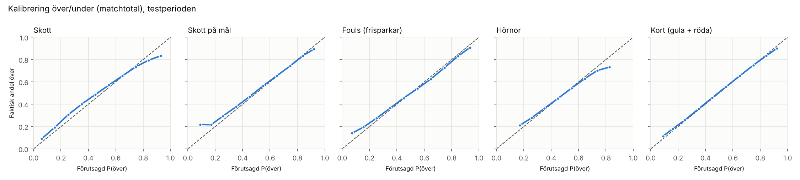

# Statistikspel – skott, skott på mål, fouls, hörnor, kort

*Genereras av `python -m src.stats_eval`. Parametrar valda på 2020–23, test 2023–26, 21 huvudligor (National League saknar statistik).*

## Kort svar

- **Modellen är bättre än ligasnittet för alla fem statistiktyper**, på testdata den inte har sett (2023–26, ~23 000 matcher). Förbättringen är säker (intervallen ligger över noll), men olika stor:
  - **Fouls** och **skott**: tydligast. Lagens stil (pressande, fysiska lag) syns starkt.
  - **Kort** och **skott på mål**: måttlig.
  - **Hörnor**: nästan inte bättre än ligasnittet. Hörnor är till stor del slump och beror på matchbilden.
- **Kalibreringen är bra:** när modellen säger 60 % "över" blir det över i ungefär 60 % av matcherna. Vid ytterligheterna (över 80 %) är modellen något för säker på skott och hörnor.
- **Det här bevisar inte att du slår spelbolagen.** Det finns inga historiska odds för statistikspel, så modellen har bara jämförts med ett enkelt ligasnitt. Bolagen har mer information: domare, laguppställningar och matchens betydelse. Använd den som en *andra åsikt* och logga dina spel, så vet vi efter några hundra spel om den ger övertag.
- **Tacklingar** finns inte i datan och ingår därför inte.
- **Kort** räknas som gula + röda. Bolagen räknar olika (t.ex. om ett andra gult kort räknas som två kort), så kontrollera reglerna hos ditt bolag.

### Valda parametrar (på valideringsdata 2020–23)

| Statistik | Halveringstid | κ (regression mot snittet) |
|---|---|---|
| Skott | 180 dagar | 5 |
| Skott på mål | 365 dagar | 20 |
| Fouls | 180 dagar | 5 |
| Hörnor | 730 dagar | 50 |
| Kort | 730 dagar | 50 |

Hög κ och lång halveringstid för hörnor och kort betyder att lagens "egen" nivå är svag och att ligasnittet väger tungt. Det stämmer med att de är mest slump.

## Resultat på testperioden

| Statistik | Matcher | Snitt per match (faktiskt / modell) | Medelfel | Korrelation | Bättre än ligasnitt? (log score per match, total) | Spridning α (total) |
|---|---|---|---|---|---|---|
| Skott | 23255 | 24.63 / 24.40 | 4.54 | 0.41 | ja: +0.0271 (+0.0219 … +0.0324) | 0.013 |
| Skott på mål | 23255 | 8.60 / 8.50 | 2.45 | 0.26 | ja: +0.0160 (+0.0125 … +0.0195) | 0.014 |
| Fouls (frisparkar) | 23255 | 24.08 / 24.11 | 4.18 | 0.48 | ja: +0.0472 (+0.0417 … +0.0526) | 0.006 |
| Hörnor | 23255 | 9.81 / 9.81 | 2.69 | 0.16 | ja: +0.0036 (+0.0010 … +0.0063) | 0.015 |
| Kort (gula + röda) | 24973 | 4.28 / 4.29 | 1.73 | 0.26 | ja: +0.0088 (+0.0066 … +0.0111) | 0.024 |

Log score = hur stor sannolikhet modellen gav det som faktiskt hände (logaritmerat). Positiv skillnad = modellen är bättre än en modell som bara känner ligans snitt och hemmafördel.

## Kalibrering per linje (matchtotal)

| Statistik | Linje | Förutsagd andel över | Faktisk andel över | Matcher |
|---|---|---|---|---|
| Skott | 22.5 | 59.8% | 62.2% | 23255 |
| Skott | 23.5 | 53.5% | 55.7% | 23255 |
| Skott | 24.5 | 47.3% | 49.2% | 23255 |
| Skott | 25.5 | 41.3% | 42.8% | 23255 |
| Skott på mål | 6.5 | 71.5% | 73.2% | 23255 |
| Skott på mål | 7.5 | 59.3% | 60.8% | 23255 |
| Skott på mål | 8.5 | 46.9% | 48.1% | 23255 |
| Skott på mål | 9.5 | 35.3% | 36.2% | 23255 |
| Fouls (frisparkar) | 22.5 | 57.7% | 58.6% | 23255 |
| Fouls (frisparkar) | 23.5 | 51.2% | 51.7% | 23255 |
| Fouls (frisparkar) | 24.5 | 44.8% | 44.8% | 23255 |
| Fouls (frisparkar) | 25.5 | 38.6% | 38.6% | 23255 |
| Hörnor | 8.5 | 62.4% | 62.6% | 23255 |
| Hörnor | 9.5 | 50.7% | 51.1% | 23255 |
| Hörnor | 10.5 | 39.4% | 39.6% | 23255 |
| Hörnor | 11.5 | 29.3% | 29.4% | 23255 |
| Kort (gula + röda) | 2.5 | 77.2% | 77.7% | 24973 |
| Kort (gula + röda) | 3.5 | 59.7% | 60.7% | 24973 |
| Kort (gula + röda) | 4.5 | 42.0% | 42.6% | 24973 |
| Kort (gula + röda) | 5.5 | 27.0% | 26.9% | 24973 |
